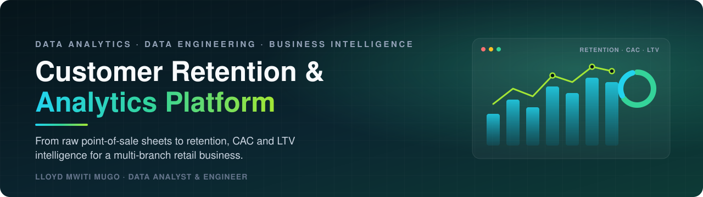
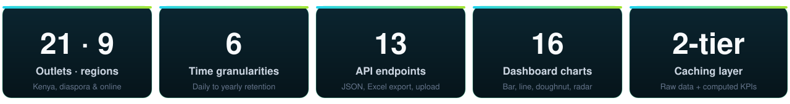

 

**Designed and built end to end by [Lloyd Mwiti Mugo](https://www.linkedin.com/in/lloyd-mwiti-mugo-94066a243/)**

[Overview](#-overview) · [Architecture](#-architecture) · [Engineering](#-data-engineering-work) · [Analytics](#-analytics-delivered) · [Hard Problems](#-hard-problems-solved) · [KPIs](#-kpi-dictionary) · [Stack](#-technology) · [Contact](#-about-me)

---

## 🧭 Overview

A multi-branch retailer sells through **21 outlets in 9 regions**: Nairobi, the Coast, Western & Nyanza, the Rift Valley, Central Kenya, the diaspora (Tanzania and Uganda) and an online store. Every sale is logged in a shared Google Sheet, but thousands of rows of transactions don't answer the questions management asks:

> *Are customers coming back? Is a new branch winning new customers or just taking them from our other shops? What does a customer cost to acquire, and is that rising? Who has gone quiet and needs a win-back call? What should we bundle?*

This platform answers them. It pulls the raw point-of-sale data, cleans and models it, computes a full suite of retention and unit-economics KPIs, and serves them through a live interactive dashboard with one-click Excel exports that marketing teams act on.

> [!NOTE]
> This is a **portfolio showcase**. The source code and all customer data are private to the business. This repository documents the design, the engineering and the problems solved. **A code walkthrough or live demo is available on request.**

---

## 🏗 Architecture

```mermaid
flowchart LR
    subgraph SRC["🗂️ Source"]
        GS[("Google Sheets<br/>POS transactions")]
        UP["CSV upload<br/>schema-validated"]
    end

    subgraph ENG["⚙️ Data Engineering Layer"]
        EXT["Extract<br/>service account or CSV export<br/>retry with backoff"]
        CLN["Clean and conform<br/>schema drift, price parsing,<br/>shop to region dimension"]
        FEAT["Feature engineering<br/>customer ID, first visit,<br/>visit-day grain"]
        CACHE["Two-tier cache<br/>raw data + computed KPIs"]
    end

    subgraph OUT["📊 Delivery"]
        KPI["KPI engine<br/>retention, cohorts,<br/>CAC, LTV, recency, bundles"]
        API["Flask REST API<br/>13 endpoints, filters"]
        UI["Interactive dashboard<br/>16 Chart.js visuals"]
        EXP["Excel target lists"]
    end

    UP --> GS
    GS --> EXT --> CLN --> FEAT --> CACHE --> KPI --> API --> UI
    API --> EXP

    classDef src fill:#0b2530,stroke:#22d3ee,color:#e2e8f0
    classDef eng fill:#0d3b36,stroke:#34d399,color:#e2e8f0
    classDef out fill:#1a2e05,stroke:#a3e635,color:#f7fee7
    class GS,UP src
    class EXT,CLN,FEAT,CACHE eng
    class KPI,API,UI,EXP out
```

---

## 🛠 Data Engineering Work

A complete data product, built end to end: ingestion, cleaning, modelling, metric engineering, performance tuning and delivery.

<table>
<tr>
<td width="50%" valign="top">

### 1 · Resilient ingestion
Two ingestion paths. The first uses **authenticated Google Sheets API** access through a service account, with credentials supplied as a file or as inline JSON for cloud deployment. The second is a **public CSV-export fallback**. Requests retry with exponential backoff on `429` and `5xx` responses and have hard timeouts. If the source goes down, the platform **keeps serving from its last good cache** instead of failing.

</td>
<td width="50%" valign="top">

### 2 · Cleaning and conforming
The sheet is maintained by hand, so the pipeline expects drift. It renames `Location` to `Shop`, normalises shop names, uses regex to strip currency symbols and text from `Price` and `MARKETING EXPENSE`, coerces bad dates and numbers safely, and **filters out B2B and organisation records** so they don't distort consumer metrics.

</td>
</tr>
<tr>
<td valign="top">

### 3 · Modelling and feature engineering
A **shop → region dimension** rolls 21 outlets up into 9 business regions. **Phone-number entity resolution** gives every customer one ID across all branches. Each customer's **first visit date** is computed once at load time, which makes the new-vs-returning and CAC calculations fast everywhere else.

</td>
<td valign="top">

### 4 · Serving and self-service
A Flask **REST API** with shop, region, granularity and date-range filters returns proper `400`, `404` and `500` responses. Teams can download **Excel target lists** of new, repeat and lapsed customers, and **upload a CSV** that is validated against the schema and written back to the source sheet.

</td>
</tr>
</table>

### ⚡ Performance engineering

| Technique | What it does |
|:--|:--|
| **Vectorised pre-grouping** | Replaced an **O(n × m)** per-customer dataframe scan with one-pass groupbys and O(1) lookups |
| **Vectorised purchase-cycle maths** | `diff()` with customer-boundary masks instead of Python loops |
| **Two-tier caching** | Raw-data cache plus a computed-response cache, each with a 30-minute TTL, and a manual refresh endpoint |
| **Lazy loading** | The first page load carries company-wide KPIs only; shop-level detail is computed when a shop is opened |
| **Parallel front-end fetches** | The branch origin analyses load concurrently with `Promise.all` |
| **Payload capping** | Long customer lists are capped (for example, the top 1,000 by recency) so the UI stays responsive |

---

## 📊 Analytics Delivered

| Area | What's analysed | Business question answered |
|:--|:--|:--|
| 🔁 **Retention** | Period-over-period retention at day, week, month, quarter, half-year and year grain | *Are customers coming back?* |
| 🧬 **Cohorts** | Cumulative New vs Returning customers and revenue from a fixed launch date | *Is growth coming from new or loyal customers?* |
| 🛒 **Repeat behaviour** | One-timers vs repeaters, lifespan, average purchase cycle | *How often do people come back, and how long do they stay?* |
| 💰 **Unit economics** | CAC, LTV proxy, and growth in repeat customers, spend, lifespan, CAC and LTV | *Is marketing spend efficient, and is it improving?* |
| 🌍 **Regional and shop** | Region totals built from shop figures, top shops per region, per-shop monthly trends | *Where is the business strongest and weakest?* |
| 🧭 **Branch origin** | For each new branch (KTDA, Kisii, Busia, Rongai, Website, Rejects): genuinely new customers vs customers moved from other shops, by source shop | *Is expansion growing the customer base, or just moving it around?* |
| ⏰ **Recency** | Monthly, Quarterly, Semi-Annual, Annual and Inactive (>1yr) brackets, with exportable lists | *Who should we win back, right now?* |
| 🎁 **Basket analysis** | Product-pair co-occurrence mining with gender split, filterable by shop, region and period | *What should we bundle, and for whom?* |
| 👥 **Segmentation** | Gender performance, top 10 products by revenue, average price and revenue per sale | *Who buys what?* |

---

## 🧩 Hard Problems Solved

| Challenge | What I did |
|:--|:--|
| 🧾 **Inflated repeat rates** | A customer buying three items in one visit shows up as three transactions. I defined a **visit as a unique customer-day**, so repeat rates measure real return visits, not basket size. |
| 🏪 **Is a new branch really growing the business?** | I built a reusable classifier that splits each branch's customers into **branch-only (new)** and **cross-shop (existing)** customers. It traces which shop each existing customer came from and how much revenue each source shop contributes. |
| ➕ **Drill-downs that didn't add up** | Region figures computed independently didn't match the sum of their shops. I now **build region totals from shop-level figures**, so every drill-down reconciles exactly. |
| 💱 **Currency-formatted prices** | Prices and marketing spend arrived as free text, with currency symbols, separators and notes mixed in. Regex cleaning plus safe numeric coercion turns them into reliable numbers. |
| 🔤 **Schema and naming drift** | The column was renamed (`Location`/`Shop`) and shop names were spelled inconsistently. Both are normalised at load time so the region mapping never silently drops rows. |
| 🏢 **B2B noise** | Organisation purchases distorted consumer metrics, so they're excluded at the ingestion layer. |
| 🐢 **Slow branch analysis** | The first version scanned the whole dataset once per customer. Rewriting it as vectorised pre-grouping made it practical on the full dataset. |
| 🌐 **Unreliable source API** | Sheets API timeouts and rate limits are handled with retries, backoff and a fallback to the last good cache, so the dashboard stays up. |
| 🔐 **Credential hygiene** | All secrets moved to environment variables, helper scripts were refactored off hard-coded key paths, and version control excludes keys, `.env` and customer exports. |

---

## 📐 KPI Dictionary

| KPI | Definition |
|:--|:--|
| **Visit** | A unique *(customer, calendar day)* pair |
| **Repeat customer** | More than one distinct visit day in the period |
| **Repeat rate** | Repeat customers ÷ unique customers · *target 20–30%* |
| **Retention rate** | Customers active in both *t* and *t−1* ÷ customers in *t−1* · *target 15–20%* |
| **Repeat revenue %** | Revenue from repeat customers ÷ total revenue |
| **Avg lifespan** | Mean days between first and last purchase (customers with a lifespan above zero) |
| **Avg purchase cycle** | Mean of each customer's average days between consecutive purchases |
| **New customer** | A customer whose first purchase ever falls in the period |
| **CAC** | Marketing expense ÷ new customers |
| **LTV (proxy)** | Period revenue ÷ active customers |
| **Recency bracket** | Days since last visit: <30 · <90 · <180 · <365 · ≥365 |

Every KPI is checked against its business target band and shown with a ✓ / ✗ status on the dashboard.

---

## 🧰 Technology

| Layer | Tools |
|:--|:--|
| **Source** | Google Sheets (POS transaction log) |
| **Ingestion** | Python, `gspread`, `google-auth`, `requests` with `urllib3` retry |
| **Transformation** | pandas, NumPy, `itertools`, `collections` |
| **Serving** | Flask, Jinja2, JSON REST APIs, Gunicorn |
| **Visualisation** | Chart.js (bar, line, doughnut, pie, radar), responsive dashboard UI |
| **Reporting** | Excel exports through `openpyxl` and `XlsxWriter` |
| **Config and security** | `python-dotenv`, environment-based secrets |
| **Deployment** | Vercel (serverless Python) |

---

## ✅ How I Validate Data

- **Mock-data unit checks.** Small hand-built datasets with known answers test retention, CAC and LTV growth, marketing attribution, bundle mining and branch-origin classification before anything touches live data.
- **Reconciliation by construction.** Region totals are built from shop figures, and branch new/existing revenue adds back up to the branch total.
- **Data profiling first.** Diagnostic scripts inspected worksheets, headers, shop spellings, price formats and dataset scale before any metric was built.
- **Endpoint checks.** API smoke tests confirm payload shape and status codes.

---

## 🎓 Skills Demonstrated

---

## 👤 About Me

### Lloyd Mwiti Mugo
**Data Analyst · Data Engineer · BI Developer**

*I turn scattered business data into pipelines, KPIs and dashboards that leaders actually use.*

*Open to conversations about data analytics, data engineering and building data products.*

